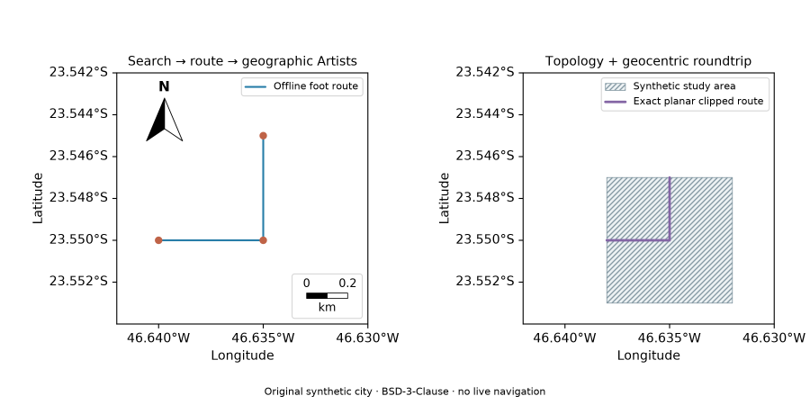
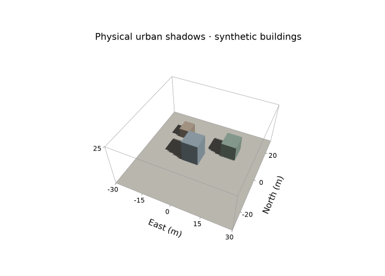
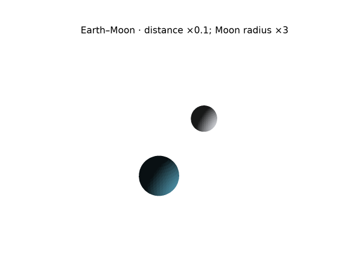
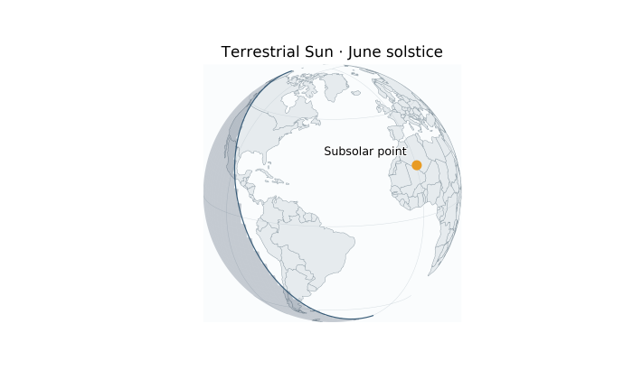
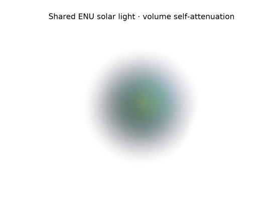

Current scope: [four deferred gates and final acceptance/publication pending](deferred-gates-0.4.md).
GPU/scientific eclipses are experimental; PBF has regional validation only.
[Latest observed evidence](observed-validation-0.4.md) is historical, not final-candidate acceptance.

# Unreleased 0.4 integration gallery

These are original Azimlib CPU-rendered development examples. They do not claim
release, performance or human platform acceptance. Reproduce PNG/SVG/PDF and optional
GPU/native outputs using [the integration validator](integration-0.4.md).
[Source and image hashes](_static/integration-0.4/manifest.json) identify this local baseline.

## Search, route, topology and coordinates

`examples/integration_040.py` connects a local synthetic geocoder and road graph,
clips a route using own topology and checks the geocentric transform. The city,
route and addresses are synthetic; the example provides no real navigation advice.

## Physical local shadows

`examples/lighting_maps.py` uses original synthetic buildings and ground in a
shared ENU frame. Shadow detail is limited by declared triangle/disk refinement;
visual edges are not an unrestricted spatial precision guarantee.

## Earth–Moon composition

`examples/lunar_maps.py` separates physical geometry from the stated visual
distance/radius scaling. This is not a precise eclipse or contact prediction.

## Terrestrial solar globe

`examples/solar_maps.py` combines the bounded solar model with orthographic
cartography. Geographic boundaries use bundled public-domain Natural Earth data.

## Lit volume

`examples/lighting_maps.py` produces a synthetic bounded volume with self-attenuation.
There is no full mesh-to-volume shadow transport. SVG embeds this raster layer;
PDF/PNG and GPU capabilities follow the [volume contract](volumes-0.4.md).

Original compositions/code: © Kernerian, BSD-3-Clause. Natural Earth and bundled
DejaVu retain their own terms in [third-party notices](../THIRD_PARTY_LICENSES.md).
No third-party reference images, raw ephemerides or unrelated desktop captures
are included. For broader capabilities, follow the [coverage matrix](integration-0.4.md)
and each subsystem's reproducible examples.
